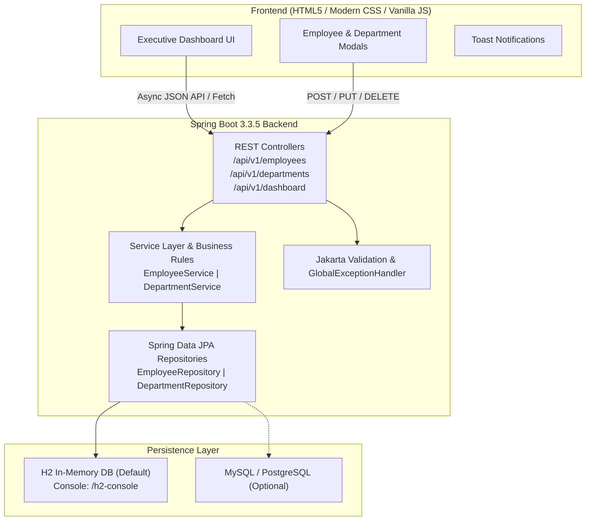

# 🏢 Employee Management System (EMS)

A full-stack, enterprise-grade **Employee Management System** built with **Spring Boot 3.3.5**, **Spring Data JPA**, **Hibernate**, and a modern, responsive **Single-Page Dashboard UI**.

---

## 🌟 Key Features

### 🔐 User-Based & Role-Based Access Control (UBAC / RBAC)
- **Three-Tier Security Roles**:
  - 👑 **`ROLE_ADMIN`**: Full permissions — create, edit, delete employees; create and delete departments; export CSV; view all analytics.
  - 💼 **`ROLE_MANAGER`**: Can create and edit employees, view analytics, and export CSV; **cannot** delete employees or modify departments.
  - 👤 **`ROLE_EMPLOYEE`**: Read-only user access — can view the directory, colleague details, and department structures; **cannot** add, edit, or delete.
- **Stateless JWT Authentication**: Secure HMAC-SHA256 tokens passed via `Authorization: Bearer <token>`.
- **Pre-Configured Demo Accounts**:
  - **Admin**: `admin` / `admin123`
  - **Manager**: `manager` / `manager123`
  - **Employee**: `user` / `user123`
- **Frontend Role Adaptation**: The UI dynamically hides or displays buttons and triggers based on the authenticated user's permissions, with 1-click quick role switcher buttons.

### 🖥️ Full-Stack Interactive Web Dashboard
- **Executive KPI Cards**: Real-time tracking of Total Staff, Active Employees, On Leave, Departments, and Payroll.
- **Department Headcount Breakdown**: Visual progress bars displaying employee distribution across divisions.
- **Dynamic Search & Filtering**: Instant debounced search (by name, email, role), department filtering, status filtering, and multi-field sorting.
- **CRUD Operations**: Modal-driven creation, viewing, updating, and deletion of employees and departments with real-time feedback.
- **CSV Data Export**: One-click download of the complete employee roster formatted in CSV (`employees.csv`).
- **Interactive Toast Notifications**: Instant visual feedback for operations and server validation errors.

### ⚙️ Robust Spring Boot 3 Backend
- **Layered Architecture**: Clear separation of concerns with `Controller` ➔ `Service` ➔ `Repository` ➔ `Entity`.
- **Validation**: Strict server-side validation using `jakarta.validation` (`@NotBlank`, `@Email`, `@Digits`, `@DecimalMin`, etc.).
- **Centralized Error Handling**: `@RestControllerAdvice` delivering consistent, structured JSON responses.
- **Zero-Setup Schema Creation**: Uses Hibernate DDL-auto to automatically create and update tables, with `createDatabaseIfNotExist=true` for MySQL.
- **Preloaded Seed Data**: Automatically populates realistic departments and staff on first run.

---

## 🏗️ Project Architecture & Tech Stack



### Tech Stack Details
- **Java**: 17 / 21+
- **Framework**: Spring Boot 3.3.5
- **ORM & Data**: Spring Data JPA / Hibernate
- **Database**: H2 (In-memory, default) / MySQL (Optional)
- **Validation**: Hibernate Validator (`jakarta.validation`)
- **Frontend**: Responsive HTML5, Vanilla JavaScript (ES6+), Modern CSS3 (CSS Variables, Flexbox/Grid)
- **Build Tool**: Apache Maven (Wrapper included: `mvnw.cmd`)

---

## 📁 Project Directory Structure

```text
c:\Full Stack Projects\Employee Management System\
├── mvnw.cmd                              # Maven Windows wrapper
├── pom.xml                               # Maven project dependencies & build
├── README.md                             # Documentation & API specs
└── src/
    ├── main/
    │   ├── java/com/ems/
    │   │   ├── EmployeeManagementApplication.java  # Main application entry point
    │   │   ├── config/
    │   │   │   └── CorsConfig.java                 # Cross-Origin Resource Sharing config
    │   │   ├── controller/
    │   │   │   ├── DashboardController.java        # Dashboard KPI metrics endpoints
    │   │   │   ├── DepartmentController.java       # Department CRUD endpoints
    │   │   │   └── EmployeeController.java         # Employee CRUD, search, filter, CSV
    │   │   ├── dto/
    │   │   │   ├── ApiResponse.java                # Standard generic response wrapper
    │   │   │   ├── DashboardStatsDTO.java          # Analytics metrics DTO
    │   │   │   ├── DepartmentDTO.java              # Department data transfer object
    │   │   │   ├── EmployeeRequestDTO.java         # Validated employee input DTO
    │   │   │   └── EmployeeResponseDTO.java        # Employee presentation DTO
    │   │   ├── exception/
    │   │   │   ├── BadRequestException.java        # HTTP 400 custom exception
    │   │   │   ├── DuplicateResourceException.java # HTTP 409 conflict exception
    │   │   │   ├── ErrorResponse.java              # Standard error payload
    │   │   │   ├── GlobalExceptionHandler.java     # RestControllerAdvice handler
    │   │   │   └── ResourceNotFoundException.java  # HTTP 404 custom exception
    │   │   ├── model/
    │   │   │   ├── Department.java                 # Department JPA Entity
    │   │   │   ├── Employee.java                   # Employee JPA Entity
    │   │   │   ├── EmployeeStatus.java             # Enum: ACTIVE, ON_LEAVE, TERMINATED
    │   │   │   └── EmploymentType.java             # Enum: FULL_TIME, PART_TIME, CONTRACT, INTERN
    │   │   ├── repository/
    │   │   │   ├── DepartmentRepository.java       # Department JPA Repository
    │   │   │   └── EmployeeRepository.java         # Employee JPA Repository & queries
    │   │   ├── service/
    │   │   │   ├── DashboardService.java           # Dashboard aggregation interface
    │   │   │   ├── DepartmentService.java          # Department business interface
    │   │   │   ├── EmployeeService.java            # Employee business interface
    │   │   │   └── impl/
    │   │   │       ├── DashboardServiceImpl.java   # Stats calculation implementation
    │   │   │       ├── DepartmentServiceImpl.java  # Department service implementation
    │   │   │       └── EmployeeServiceImpl.java    # Employee service implementation
    │   │   └── util/
    │   │       └── DataInitializer.java            # CommandLineRunner sample seeder
    │   └── resources/
    │       ├── application.properties              # DB & server configuration
    │       └── static/
    │           ├── index.html                      # Single-page dashboard markup
    │           ├── css/
    │           │   └── style.css                   # Modern CSS styling
    │           └── js/
    │               └── app.js                      # Client app state & API integrations
    └── test/
        └── java/com/ems/
            ├── EmployeeManagementApplicationTests.java
            └── service/
                └── EmployeeServiceTest.java        # Unit tests with Mockito
```

---

## 🚀 Getting Started

### Prerequisites
- **Java Development Kit (JDK)**: 17, 21, or newer.
- No global Maven installation required (wrapper script `mvnw.cmd` is included).

### Running the Application

1. Open PowerShell or Command Prompt in the project folder:
   ```powershell
   cd "c:\Full Stack Projects\Employee Management System"
   ```

2. Run the application using the Maven wrapper:
   ```powershell
   .\mvnw.cmd spring-boot:run
   ```
   *(Or if you have Maven installed globally: `mvn spring-boot:run`)*

3. Once started, open your web browser:
   - **Interactive Web Dashboard**: [http://localhost:8080](http://localhost:8080)
   - **H2 Database Console**: [http://localhost:8080/h2-console](http://localhost:8080/h2-console)
     - *JDBC URL*: `jdbc:h2:mem:emsdb`
     - *Username*: `sa`
     - *Password*: *(leave empty)*

---

## 📡 REST API Reference

All responses follow a standard envelope:
```json
{
  "success": true,
  "message": "Operation successful",
  "data": { ... },
  "timestamp": "2026-11-25T19:30:00"
}
```

### 1. Employees Endpoints (`/api/v1/employees`)

| Method | Endpoint | Description |
| :--- | :--- | :--- |
| `GET` | `/api/v1/employees` | Get paginated employees (supports `keyword`, `departmentId`, `status`, `page`, `size`, `sortBy`, `direction`) |
| `GET` | `/api/v1/employees/all` | Get full unpaginated list of employees |
| `GET` | `/api/v1/employees/{id}` | Get single employee details |
| `POST` | `/api/v1/employees` | Create a new employee |
| `PUT` | `/api/v1/employees/{id}` | Update existing employee details |
| `PATCH` | `/api/v1/employees/{id}/status?status=ON_LEAVE` | Quickly update employee status |
| `DELETE`| `/api/v1/employees/{id}` | Remove an employee record |
| `GET` | `/api/v1/employees/export/csv` | Download employee roster as CSV |

#### Sample Create Employee Request (`POST /api/v1/employees`):
```json
{
  "firstName": "Grace",
  "lastName": "Hopper",
  "email": "grace.hopper@company.com",
  "phone": "+1 (555) 321-4567",
  "jobTitle": "Lead Systems Architect",
  "departmentId": 1,
  "salary": 140000.00,
  "hireDate": "2023-03-01",
  "employmentType": "FULL_TIME",
  "status": "ACTIVE",
  "address": "100 Science Park, Arlington, VA"
}
```

---

### 2. Department Endpoints (`/api/v1/departments`)

| Method | Endpoint | Description |
| :--- | :--- | :--- |
| `GET` | `/api/v1/departments` | List all departments with headcount |
| `GET` | `/api/v1/departments/{id}` | Get department by ID |
| `POST` | `/api/v1/departments` | Create new department (`name`, `code`, `location`, `description`) |
| `PUT` | `/api/v1/departments/{id}` | Update existing department |
| `DELETE`| `/api/v1/departments/{id}` | Delete department (prevented if staff is assigned) |

---

### 3. Dashboard Endpoints (`/api/v1/dashboard`)

| Method | Endpoint | Description |
| :--- | :--- | :--- |
| `GET` | `/api/v1/dashboard/stats` | Retrieve total staff, active staff, department distribution, total & average payroll |

---

## 💾 Database Configuration: Switching to MySQL

To use MySQL instead of the default H2 in-memory database:
1. Open `src/main/resources/application.properties`.
2. Comment out the H2 lines and configure your MySQL credentials:
   ```properties
   spring.datasource.url=jdbc:mysql://localhost:3306/ems_db?createDatabaseIfNotExist=true&useSSL=false&serverTimezone=UTC
   spring.datasource.username=root
   spring.datasource.password=your_password
   spring.datasource.driver-class-name=com.mysql.cj.jdbc.Driver
   spring.jpa.database-platform=org.hibernate.dialect.MySQLDialect
   spring.jpa.hibernate.ddl-auto=update
   ```

---

## 🧪 Testing

Execute automated unit tests with:
```powershell
.\mvnw.cmd test
```
The test suite validates:
- Spring Boot Application Context Loading (`EmployeeManagementApplicationTests`)
- Business logic, DTO mapping, validations, and duplicate email prevention via Mockito (`EmployeeServiceTest`).
